# How to Test the App

## Student Information

- **Student Name:** Lwin Pyae Aung
- **Student ID:** 6726129

## Deployed Application

| Part              | URL                                                                                     |
| ----------------- | --------------------------------------------------------------------------------------- |
| Frontend (React)  | https://csx4107-coursefinalexam-frontend.vercel.app                                     |
| Backend (Next.js) | https://csx4107-coursefinalexam-backend.vercel.app                                      |
| Source code       | https://github.com/ZaydenMiles/2026-1-CSX4107-541-_WebDev_FinalExam                      |
| Backend source    | https://github.com/ZaydenMiles/2026-1-CSX4107-541-_WebDev_FinalExam/tree/main/next-backend   |
| Frontend source   | https://github.com/ZaydenMiles/2026-1-CSX4107-541-_WebDev_FinalExam/tree/main/react-frontend |

The deployed app uses the same test credentials below. See [Deployment](#deployment-vercel) for how it is set up.

## Test Credentials

All test accounts use the password **`password123`**. You can log in with either the username or the email.

| Role    | Username   | Email                  | Password      | Display Name   |
| ------- | ---------- | ---------------------- | ------------- | -------------- |
| Teacher | `teacher1` | `teacher1@example.com` | `password123` | Alice Johnson  |
| Teacher | `teacher2` | `teacher2@example.com` | `password123` | Bob Smith      |
| Teacher | `teacher3` | `teacher3@example.com` | `password123` | Carol Williams |
| Student | `student1` | `student1@example.com` | `password123` | David Lee      |
| Student | `student2` | `student2@example.com` | `password123` | Emma Brown     |
| Student | `student3` | `student3@example.com` | `password123` | Frank Miller   |

These accounts are created by `npm run seed` (see step 1 below).

## Prerequisites

- Node.js 20.6 or newer (the seed script uses `node --env-file`)
- npm
- A running MongoDB server, either local (`mongodb://127.0.0.1:27017`) or a MongoDB Atlas connection string
- Ports **3000** (backend) and **5173** (frontend) must be free. In development the backend only accepts CORS requests from `http://localhost:5173`.

## How to Run & Test

### 1. Backend Setup (`next-backend/`)

```bash
cd next-backend
npm install
cp .env.example .env.local
```

Edit `next-backend/.env.local`:

```
MONGODB_URI=mongodb://127.0.0.1:27017
JWT_SECRET=any-long-random-string
```

Load the test data, then start the API on http://localhost:3000:

```bash
npm run seed
npm run dev
```

`npm run seed` resets the `wad_final_course` database and creates the 6 test users and 8 sample courses. Run it again at any time to get back to a clean state.

### 2. Frontend Setup (`react-frontend/`)

In a second terminal:

```bash
cd react-frontend
npm install
cp .env.example .env
npm run dev
```

Open http://localhost:5173.

### 3. Testing Walkthrough

#### Seed data

| Course                          | Teacher  | Status | Enrolled / Max | Enrolled Students    |
| ------------------------------- | -------- | ------ | -------------- | -------------------- |
| Introduction to Web Development | teacher1 | Open   | 2 / 30         | student1, student2   |
| Advanced React Patterns         | teacher1 | Close  | 1 / 20         | student1             |
| jQuery Legacy Workshop          | teacher1 | Cancel | 0 / 10         |                      |
| Database Design with MongoDB    | teacher2 | Open   | 2 / 2 (full)   | student1, student2   |
| Node.js API Fundamentals        | teacher2 | Open   | 0 / 25         |                      |
| UX Design Basics                | teacher3 | Open   | 1 / 15         | student3             |
| Python for Data Analysis        | teacher3 | Open   | 0 / 40         |                      |
| Mobile App Prototyping          | teacher3 | Cancel | 1 / 20         | student3             |

#### Teacher functions (log in as `teacher1`)

Open http://localhost:5173 and sign in with `teacher1` / `password123`. Any page you open without logging in redirects here. The **Teacher demo** and **Student demo** buttons fill in a test account for you.

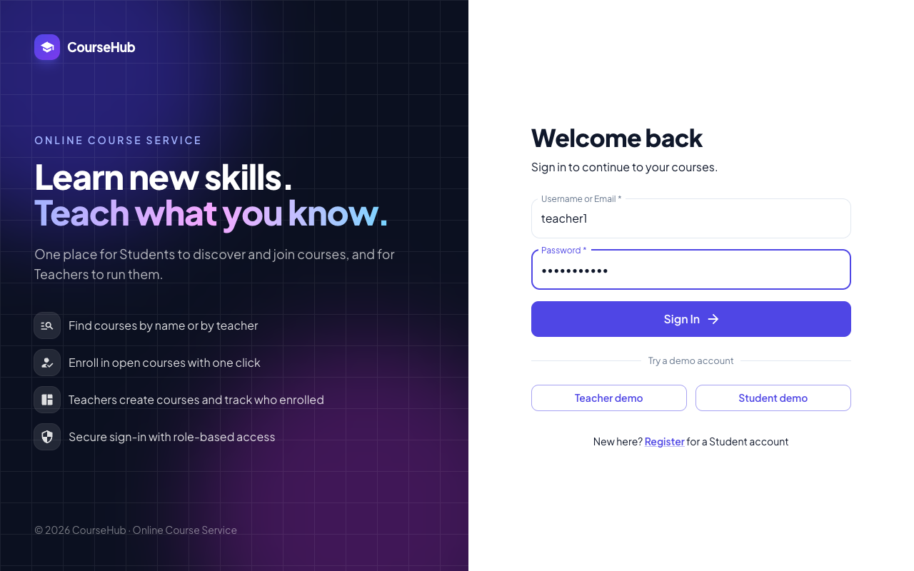

1. **My Courses** lists only Alice's 3 courses with status, duration, price and enrolled count. Delete is greyed out for courses that have students.

   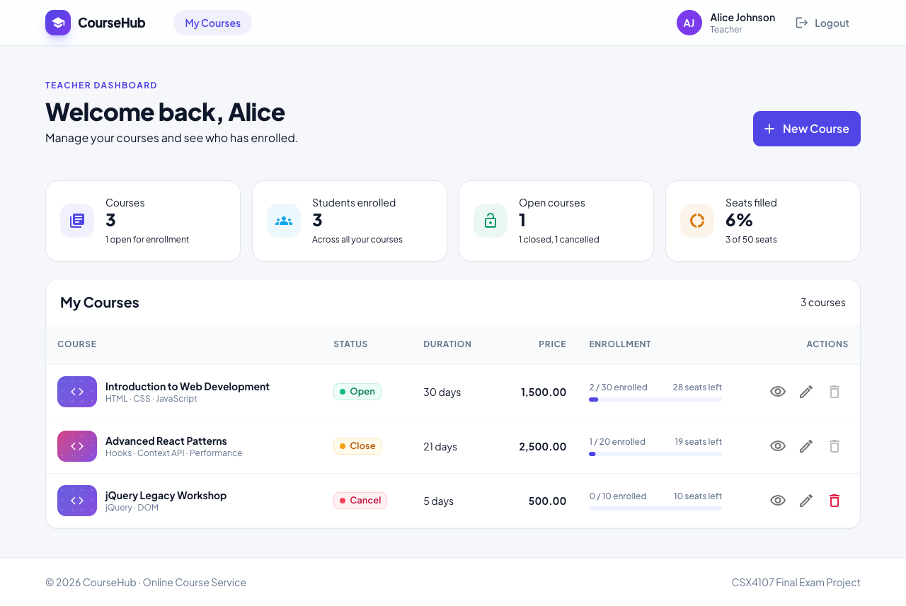

2. Click **New Course**, fill in name, duration, price, max student and status, and add topics (press Enter or comma after each one). Click **Create Course** to open the new course's details.

   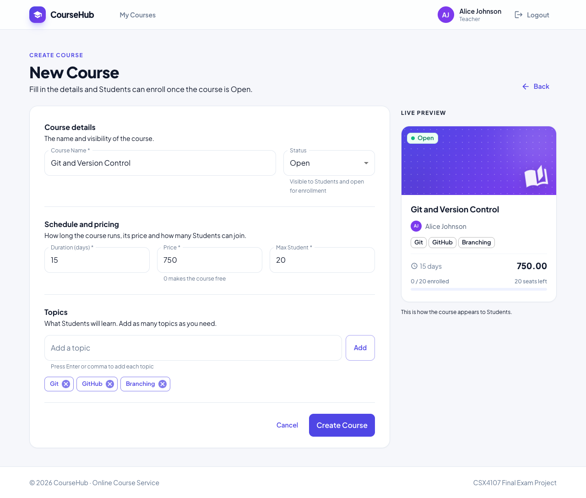

3. Open **Introduction to Web Development**. The details page shows the enrolled students (student1 and student2).

   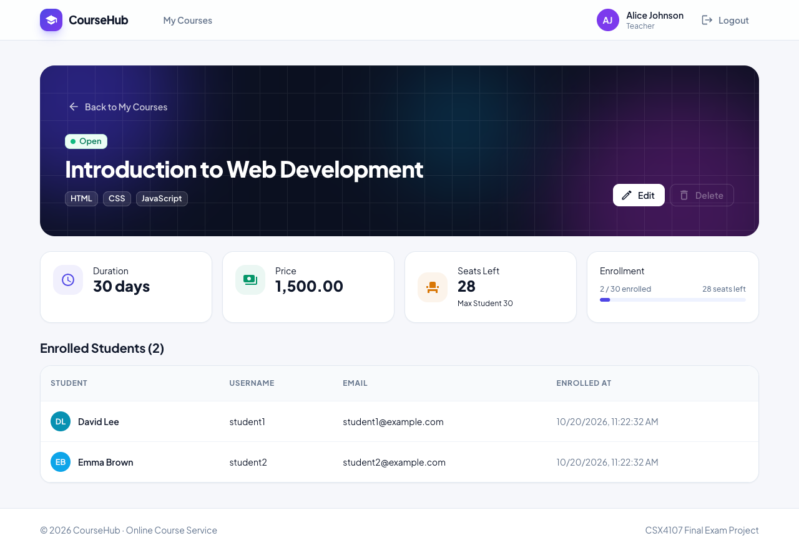

4. Click **Edit**, change the price or status, then click **Save Changes**. Setting Max Student below the 2 enrolled students is rejected.

   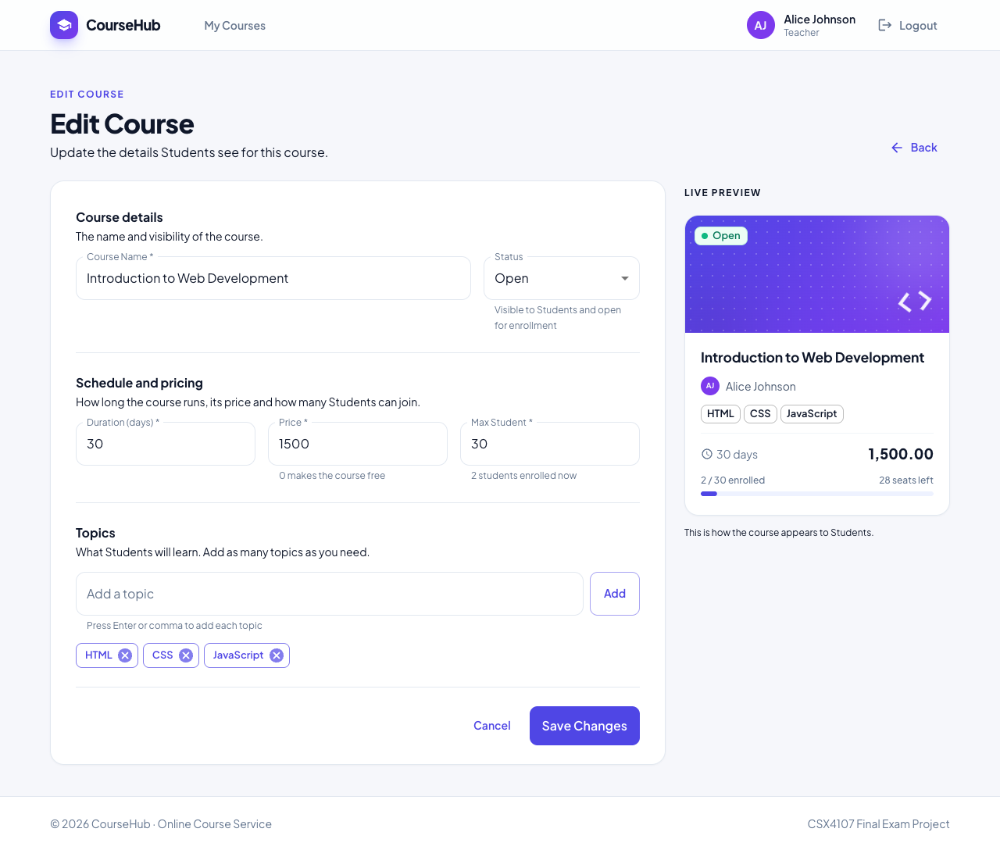

5. The **Delete** button is disabled for courses with enrolled students. Delete **jQuery Legacy Workshop** (no students) and confirm.

   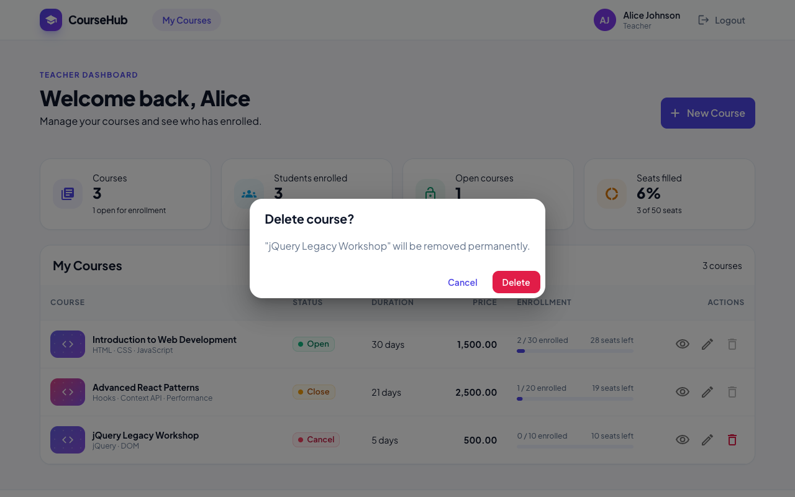

6. Click **Logout**.

#### Student functions (log in as `student3`)

1. **Browse Courses** shows 6 courses. The 2 cancelled courses are hidden.

   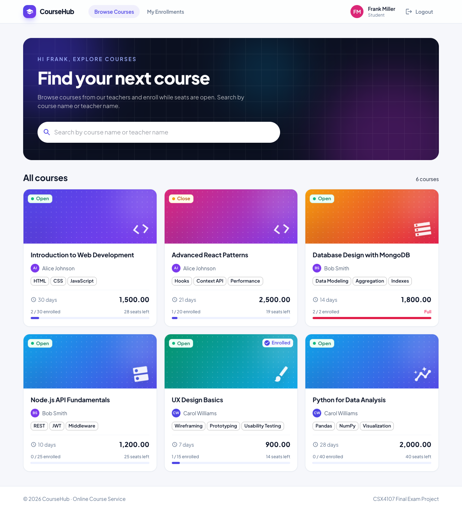

2. Type `mongo` in the search box to filter by course name, or `bob` to filter by teacher name.

   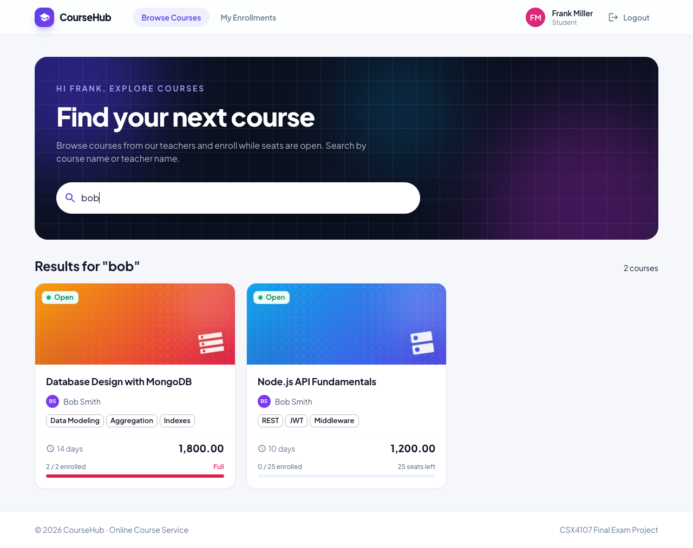

3. Open **Database Design with MongoDB**. It is full, so Enroll is disabled.

   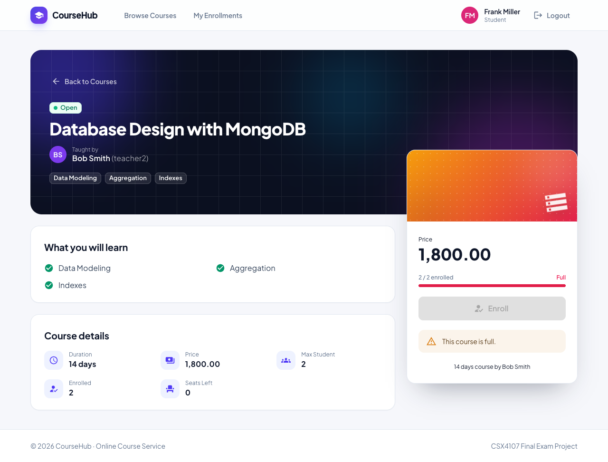

4. Open **Advanced React Patterns**. Its status is Close, so Enroll is disabled.

   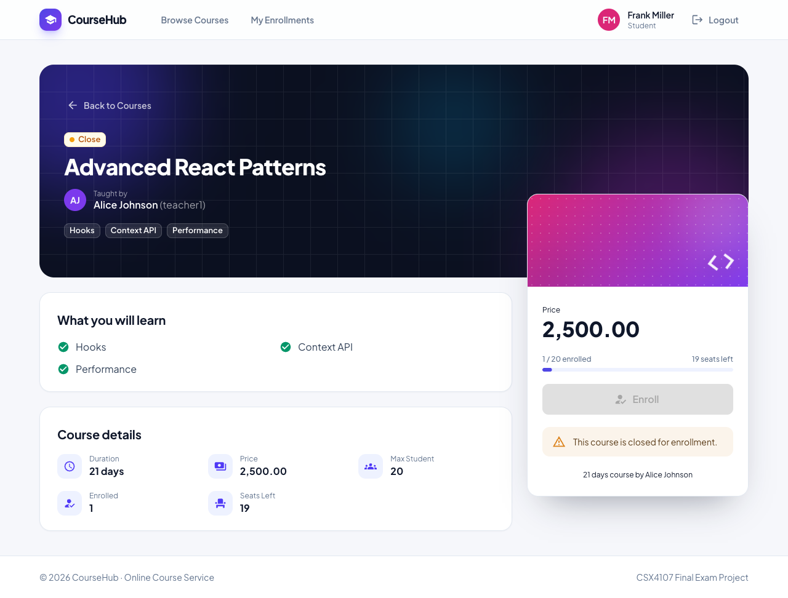

5. Open **Node.js API Fundamentals** and click **Enroll**. The seat count drops and the button changes to Enrolled. Clicking again is not possible, and the API rejects a second enrollment.

   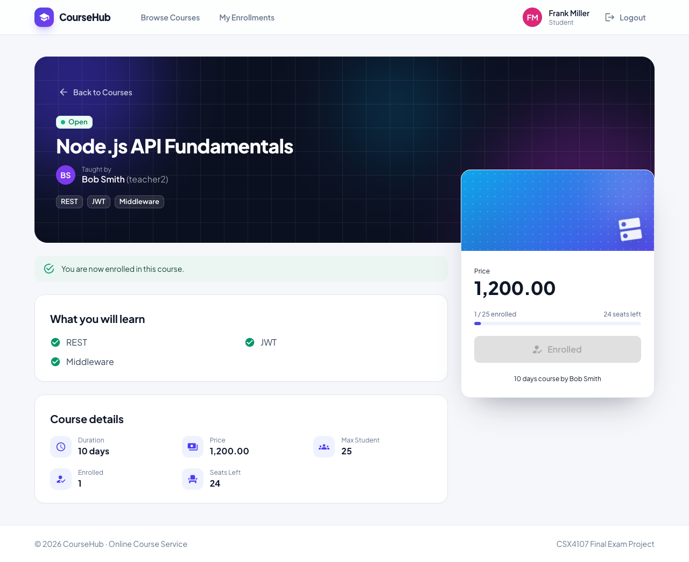

6. Open **My Enrollments** to see Node.js API Fundamentals and UX Design Basics. student3 is also enrolled in Mobile App Prototyping, but it is cancelled, so it is hidden from Students everywhere.

   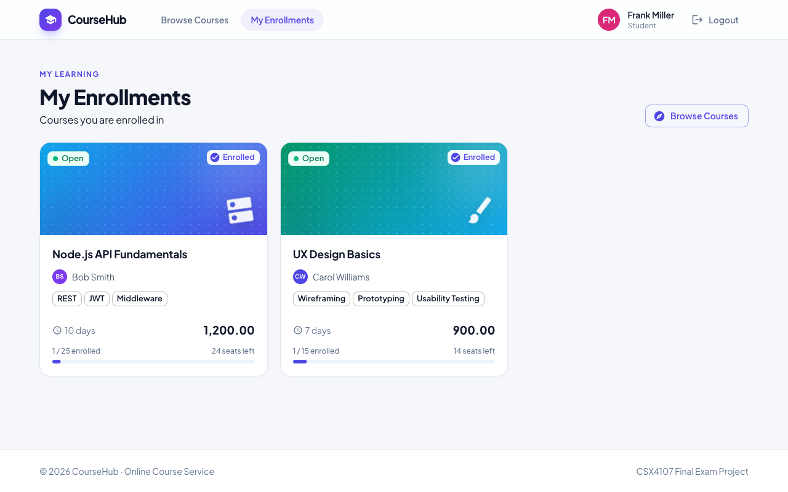

7. Click **Logout**, then **Register** on the login page. Registration only creates Student accounts.

   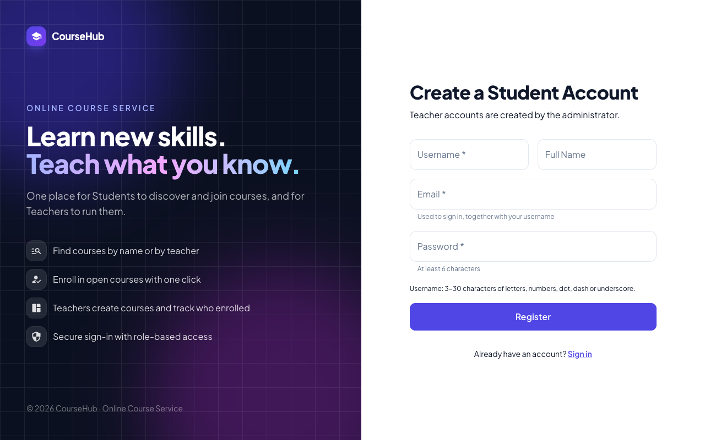

#### Backend enforcement

Every rule is checked by the API itself, not only by the UI. A few checks with `curl` (run from any folder while the backend is running):

```bash
curl -i http://localhost:3000/api/course
```

Returns `401 Unauthorized Request` because there is no login cookie.

```bash
curl -c student.txt -H "Content-Type: application/json" -d '{"username":"student1","password":"password123"}' http://localhost:3000/api/auth/login
```

```bash
curl -i -b student.txt -H "Content-Type: application/json" -d '{"courseName":"Hack","duration":1,"topics":["x"],"price":0,"maxStudent":1}' http://localhost:3000/api/course
```

Returns `403 Only Teachers can create courses`.

| Rule                                                   | Response |
| ------------------------------------------------------ | -------- |
| Any course or user endpoint without a valid login       | 401      |
| Student creates, updates or deletes a course            | 403      |
| Teacher views, updates or deletes another teacher's course | 403   |
| Teacher deletes a course that has enrolled students     | 409      |
| Max Student set below the current enrolled count        | 409      |
| Student enrolls in a Close course or a full course      | 409      |
| Student enrolls in the same course twice                | 409      |
| Student opens or enrolls in a Cancel course             | 404      |
| Registering an account with a role other than Student   | 403      |

Enrollment is a single atomic MongoDB update, so two students can never both take the last seat.

## Deployment (Vercel)

The backend and the frontend are deployed as two Vercel projects from this repository.

| Vercel project | Root Directory   | Framework Preset | Environment variables                       |
| -------------- | ---------------- | ---------------- | ------------------------------------------- |
| Backend        | `next-backend`   | Next.js          | `MONGODB_URI`, `JWT_SECRET`, `FRONTEND_URL` |
| Frontend       | `react-frontend` | Vite             | `VITE_API_URL`                              |

| Variable       | Project  | Value                                                                                                   |
| -------------- | -------- | ------------------------------------------------------------------------------------------------------- |
| `MONGODB_URI`  | Backend  | MongoDB Atlas connection string. Atlas **Network Access** must allow `0.0.0.0/0`, because Vercel has no fixed IP address. |
| `JWT_SECRET`   | Backend  | A long random string                                                                                    |
| `FRONTEND_URL` | Backend  | The deployed frontend URL, for example `https://my-frontend.vercel.app`. It is the allowed CORS origin. |
| `VITE_API_URL` | Frontend | The deployed backend URL, for example `https://my-backend.vercel.app`. Vite reads it at build time, so redeploy the frontend after changing it. |

**Deploy order**

1. Deploy the backend with `MONGODB_URI` and `JWT_SECRET`.
2. Deploy the frontend with `VITE_API_URL` set to the backend URL.
3. Set `FRONTEND_URL` on the backend to the frontend URL and redeploy the backend.
4. Load the test data into the Atlas database once, from your computer: `npm run seed` in `next-backend` with `.env.local` pointing at Atlas.

**Login across the two sites.** The frontend and the backend get different `*.vercel.app` addresses, which browsers treat as different sites. The backend sets the httpOnly `token` cookie with `SameSite=None; Secure` and also returns the token in the login response. The frontend sends it in an `Authorization: Bearer` header. Login therefore works in browsers that block cross-site cookies, such as Safari and Brave, as well as in Chrome.

## Data Model

The app uses two collections in the `wad_final_course` database.

**`users`**

| Field                    | Type       | Notes                          |
| ------------------------ | ---------- | ------------------------------ |
| `_id`                    | ObjectId   |                                |
| `username`               | string     | Unique, lowercase              |
| `email`                  | string     | Unique, lowercase              |
| `password`               | string     | bcrypt hash, never returned by the API |
| `name`                   | string     | Display name                   |
| `role`                   | string     | `Student` or `Teacher`         |
| `createdAt`, `updatedAt` | Date       |                                |

**`courses`**

| Field                    | Type                       | Notes                                              |
| ------------------------ | -------------------------- | -------------------------------------------------- |
| `_id`                    | ObjectId                   |                                                    |
| `courseName`             | string                     |                                                    |
| `duration`               | number                     | Days, whole number, at least 1                     |
| `topics`                 | string[]                   | At least one topic                                 |
| `price`                  | number                     | 0 or more                                          |
| `maxStudent`             | number                     | Whole number, at least 1                           |
| `status`                 | string                     | `Open`, `Close` or `Cancel`                        |
| `teacherId`              | ObjectId                   | References `users._id` of the owning Teacher       |
| `students`               | `[{ userId, enrolledAt }]` | Each `userId` references `users._id` of a Student  |
| `createdAt`, `updatedAt` | Date                       |                                                    |

**Relationships**

- **Teacher to Course (one-to-many):** every course stores its owner in `teacherId`. All Teacher operations filter by it, which is how ownership is enforced.
- **Student to Course (many-to-many, the enrollment):** a course keeps the enrolled Students as references in `students`. A Student's enrolled courses are found with `students.userId`. The Teacher's course details look up these ids in `users` to show each Student's name and email.
- Keeping the enrollments inside the course document lets one atomic update check the status (Open), the seats left (`students` size below `maxStudent`) and duplicates (`userId` not already listed) at the same time. The rules still hold when several Students enroll at once.

## API Endpoints

| Method | Endpoint                        | Access             | Description                                                                                       |
| ------ | ------------------------------- | ------------------ | ------------------------------------------------------------------------------------------------- |
| POST   | `/api/auth/login`               | Public             | Log in with `{ username, password }` (username or email). Sets an httpOnly `token` cookie and also returns the token. Protected endpoints accept the cookie or an `Authorization: Bearer <token>` header. |
| POST   | `/api/auth/logout`              | Public             | Clears the `token` cookie.                                                                         |
| POST   | `/api/user`                     | Public             | Register a Student account `{ username, name, email, password }`. Any other role is rejected (403). |
| GET    | `/api/user`                     | Logged in          | The current user (used to restore the session on page reload).                                   |
| GET    | `/api/user/:user_id`            | That user only     | The user's own profile.                                                                            |
| GET    | `/api/course`                   | Logged in          | Teacher: own courses. Student: all courses except Cancel. `?q=` filters by course or teacher name. Student `?enrolled=true`: enrolled courses, except Cancel. |
| POST   | `/api/course`                   | Teacher            | Create a course `{ courseName, duration, topics, price, maxStudent, status }`.                     |
| GET    | `/api/course/:course_id`        | Owner Teacher, Student | Course details. The owning Teacher also gets the enrolled students. Students get 404 for a Cancel course. |
| PATCH  | `/api/course/:course_id`        | Owner Teacher      | Update any of the course fields.                                                                   |
| DELETE | `/api/course/:course_id`        | Owner Teacher      | Delete, only when no Student is enrolled.                                                          |
| POST   | `/api/course/:course_id/enroll` | Student            | Enroll, only when the course is Open, has seats left and the Student is not enrolled yet.          |
